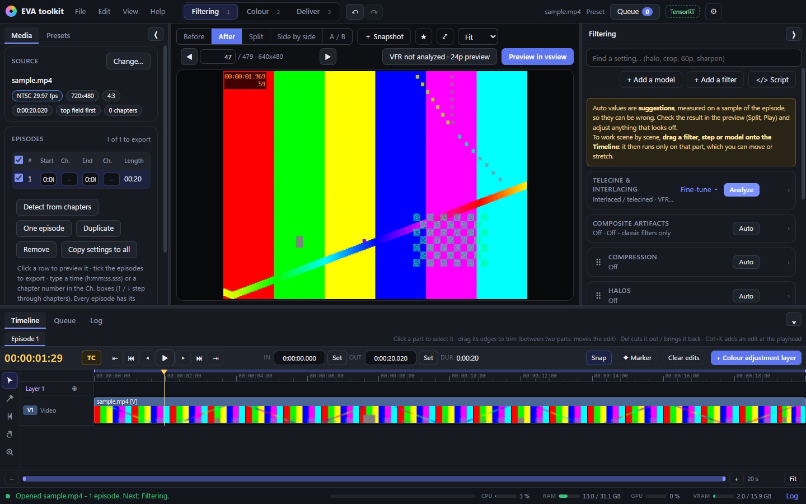

# EVA toolkit v0.3 alpha

Restores NTSC and PAL DVD video, other video files and still images: anime, cartoons and live action.
A Windows desktop app (Electron front-end, Python + VapourSynth engine, PyTorch / TensorRT networks).

> **Alpha.** It works on the discs it was tuned on and passes its self-test (65 checks), but expect rough edges.
> Bug reports with a sample are very welcome (Issues). **Help → Report a problem** in the app makes the report for you.



**New here? Read the [easy guide](docs/guide/GUIDE.md)** (with pictures) or the **[wiki](../../wiki)**.

## Download and run

1. Download **`EVAtoolkit-v0.3-alpha.zip`** from [Releases](../../releases) (about 0.5 GB).
2. Unpack it anywhere: another drive or a USB disk is fine.
3. Start **`EVA toolkit.exe`**.
4. **First start:** the *Dependencies* window installs what the engine needs with one click, into `runtime\` next to
   the app: Python 3.12, PyTorch (CUDA 13), TensorRT, VapourSynth, ffmpeg and MKVToolNix. That is about
   **5.5 GB download, 9 GB on disk**, from their official download sites. Nothing is installed outside the folder:
   no registry, no PATH, no admin rights. Then press *Start EVA toolkit*.

The folder stays portable: move or copy it any time. The app can update itself (*Settings → Updates*).
Optional: `Self-test.bat` checks every stage on test footage it makes itself.

### Needs

* Windows 10 / 11, 64-bit, internet for the first start.
* An **NVIDIA GPU** with a current driver (RTX 20-series or newer recommended). Without one the neural stages run on
  the CPU and are very slow.
* About 10 GB of free disk space, more for the work folders of long episodes.

## What it does

* **Inverse telecine** (VFR / CFR), **60p deinterlace** for tape-shot video, and PAL field matching or deinterlacing.
  Progressive sources (23.976p to 60p, HD files) are recognised from the picture and keep their own frame rate.
  One **Analyze** button decides it all.
* **Dot crawl and rainbows**, **MPEG blocking**, **halos / ringing**, **colour bleed and shift** (RepairNet, HaloNet,
  ChromaNet, BlockNet, FieldNet), clean white / black, and a **temporal stabilizer** (Universal) that steadies flicker,
  boil and line wobble without dragging cuts, fades or flashes into the next frame.
* **Colour** like a grading page: scopes, wheels, curves, LUTs and **adjustment layers on the Timeline**, with
  **Auto colour** and **Auto white balance**.
* **A Timeline editor**: razor, ripple, cut parts out, run any step or filter on only a range, adjustment layers.
* **A library of 450+ filters** (VapourSynth plugins, vs-jetpack, the app's own stages, your own code) and
  **AI models** (`.onnx`, `.pth`, `.safetensors`) with a **model library** that keeps, shows, builds and deletes
  their TensorRT engines.
* Encode (x264 / x265 / SVT-AV1 / NVENC / ProRes / FFV1 / UT Video) and mux with all audio and subtitle tracks, a
  sound **and picture** sync check, and cuts joined exactly. Stills are saved as 16-bit PNG.
* Opens `.iso` images, `VIDEO_TS` folders and Blu-ray `BDMV` folders directly. Damaged discs: undecodable frames are
  found in seconds and replaced.

## New in v0.3 alpha

* **A new window**: *Filtering → Colour → Deliver* over a Timeline, Media / Presets on the left, a live script beside
  the steps. Everything on one screen.
* **Delete or add steps**: every built-in step has a ✕, **Delete all steps** starts empty, **+ Add a filter** builds your
  own chain. A deleted step does nothing; filters placed after it still run.
* **The filter library** (over 450): searchable, categorised, with before / after of the current frame and the script
  of every filter. **75 more VapourSynth plugins** are in it (bm3d, cas, dedot, dotkill, fmtconv, removegrain, eedi3,
  descale, chromanr, ttempsmooth, zboxblur…), each one load-tested, plus three stabilizers (**Stab**, **Steady camera**,
  **Stab, repeated**) built on MVTools' Depan functions.
* **Models**: compact AI model nodes you can drag by the whole header, a **model library** per model (list / pick /
  edit / build / delete engines, with a build progress bar), and **upscale models by [evana01](https://huggingface.co/evana01)**
  in the zip (`models\upscale`: 2xGTv6-cel, 2xGTv5-cel, 2xGTv5-digipaint, 2xGTv4, 2xGTv4.5, 1xGTv4.5s; non-commercial).
* **Timeline**: razor / cut / ripple, ranges of 1/30 of the episode by default, colour layers and LUT layers, jumps
  held exactly, picture-vs-sound check.
* **Analyze** and **Auto** everywhere; a rebuilt IVTC with a truth benchmark; a faster damaged-frame scan (a disc
  that took an hour to analyse now takes two minutes); auto-update; progressive-source detection.
* **Reliability**: a persistent log, **Help → Report a problem**, auto-save of your settings per source, Reload.
* Faster opening, previews, frame stepping and stabilizer.

## Source layout

| Folder | What |
|---|---|
| `app/` | Electron front-end (`main.js`, `deps.js` = the Dependencies installer, `update.js`, `renderer/`) |
| `core/` | the engine: `server.py` (backend), `runner.py` (probe / export / mux), `vsgraph.py` (processing chain), `blocks.py` (filter library), networks; `requirements.txt` = exact package versions |
| `models/` | trained network weights (+ the network code some need) and `upscale/` (evana01's models) |
| `my_filters/` | examples of your own filters (`stabilizers.py` is one); plugin `.dll`s go in `my_filters\plugins` |
| `docs/guide/` | the easy guide and its pictures |
| `tools/` | `selftest.py`, `build_portable.py` (makes the release folder + zip), `launcher.cs` (`EVA toolkit.exe`), `make_icon.py` |

### Run from source

```powershell
cd app
npm install
cd ..
python -m pip install -r core\requirements.txt
app\node_modules\electron\dist\electron.exe app
```

Python 3.12 is needed; ffmpeg (a *full* build, with the DVD-Video reader) and `mkvmerge` must be on PATH or in
`runtime\ffmpeg\` and `runtime\mkvtoolnix\`. The 75 extra VapourSynth plugins are only in the release zip (they are
large binaries): drop your own `.dll` plugins into `my_filters\plugins`.

### Build the release

```powershell
python tools\build_portable.py dist\EVAtoolkit-v0.3-alpha --zip
```

## Licence

EVA toolkit is free software under the **MIT License** (see `LICENSE`).
The release zip also contains other people's work, each under its own licence: the VapourSynth plugins in
`my_filters\plugins` (sources and hashes in `_sources.json`), NeuFlow v2 (`models\neuflow\LICENSE`) and the upscale
models by evana01 (`models\upscale\README.txt`: CC BY-NC / CC BY-NC-ND, non-commercial).
