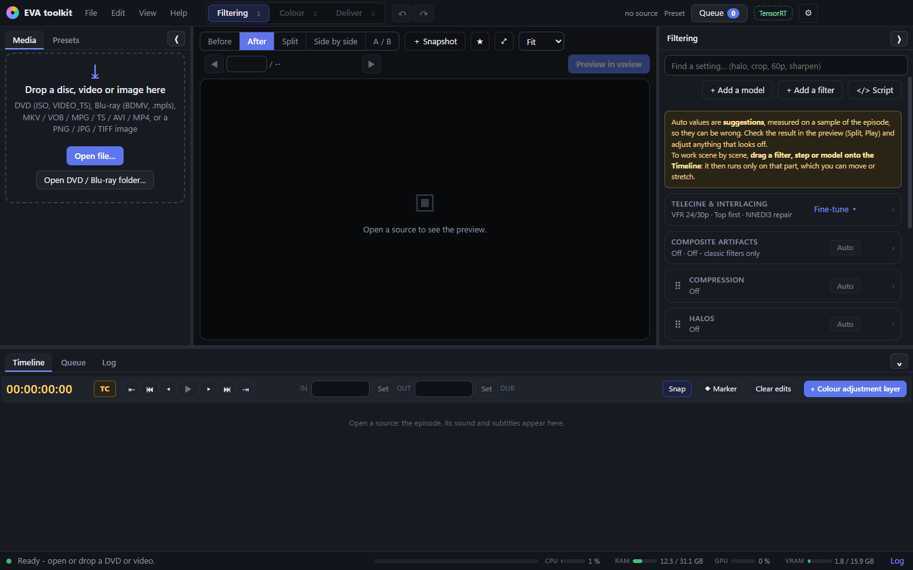
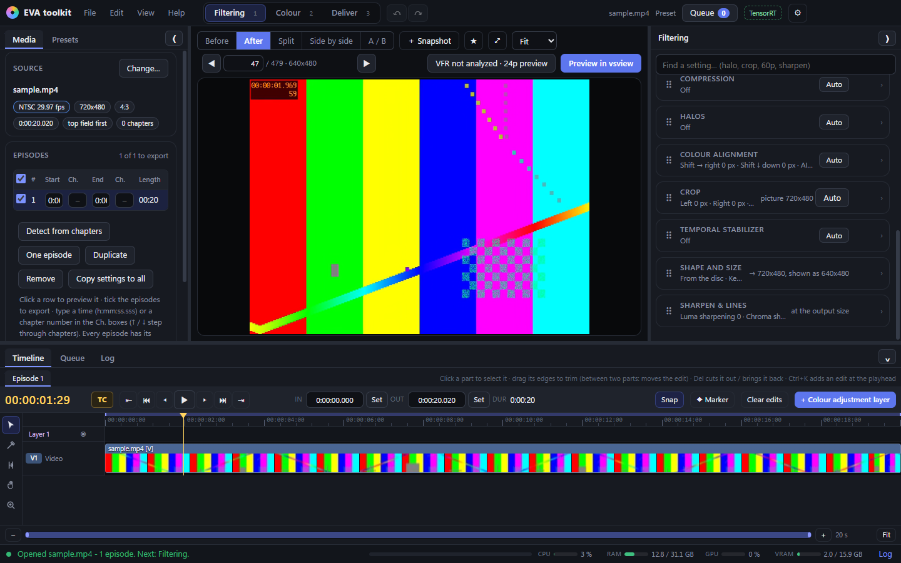
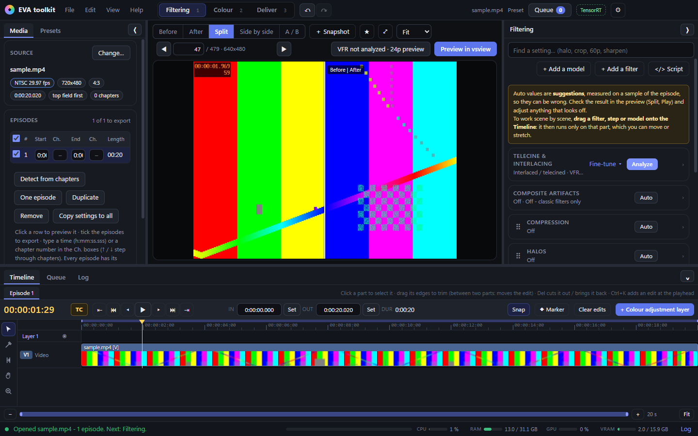
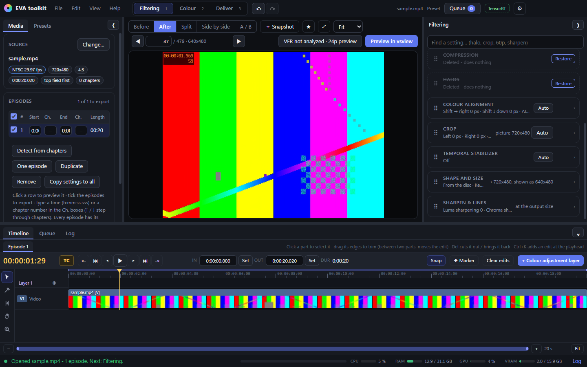
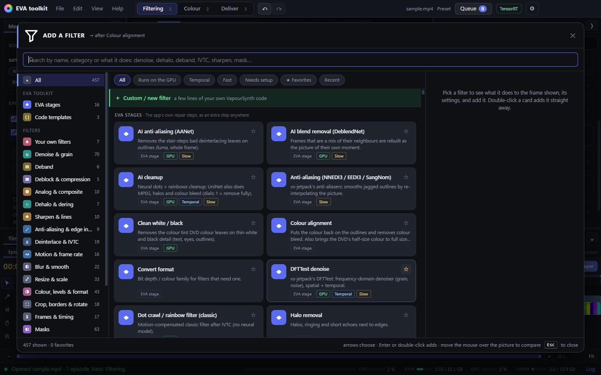
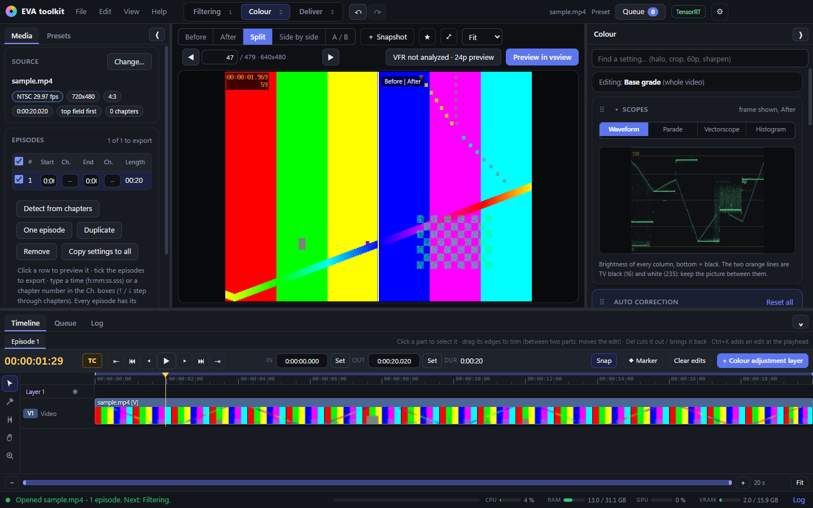
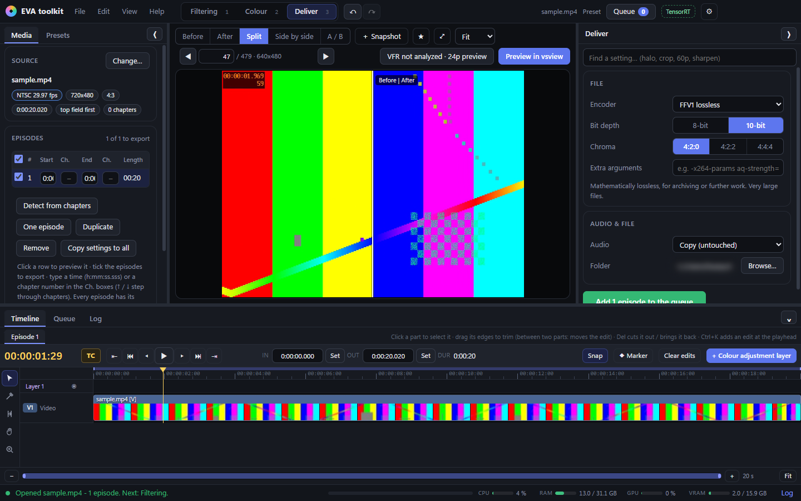

# EVA toolkit: an easy guide

From a disc or a video file to a restored file, in eight steps. The pictures use a made-up test clip, so nothing
personal is in them.

> **Tip:** you never have to touch every setting. Press the **Auto** / **Analyze** buttons, look at the preview, and
> only change what you don't like.

## 1. Start

Start `EVA toolkit.exe`. On the very first start the **Dependencies** window installs what the engine needs (about
5.5 GB, one click, nothing goes outside the folder). See [Installation](https://github.com/EVA0111/EVA-toolkit/wiki/Installation).

The window has three parts:

* **Left:** *Media* (your sources and episodes) and *Presets* (saved settings).
* **Middle:** the preview with **Before / After / Split / Side by side / A-B**, and the **Timeline** underneath.
* **Right:** the **Inspector**. The three tabs at the top are the steps: **Filtering → Colour → Deliver**.

## 2. Open a source

Drop a DVD (`.iso`, `VIDEO_TS`), a Blu-ray, a video file or an image onto the window, or press **Open file…**.
For a disc, choose the title (the longest is picked for you) and press **Import**.

The left side now shows what the file is (NTSC / PAL, size, aspect, length, chapters). Long files are split into
**episodes** from their chapters; check them and press **One episode** if you want the whole thing.

## 3. Press Analyze

In **Filtering**, the first group is **Telecine & interlacing**. Press **Analyze**: it looks at the picture (not only
at the flags), tells you whether it is progressive, telecined or interlaced, and sets the frame rate and the
repairs for you. After that you can press **Auto** on any other group.

Every step shows its name, a one-line summary of what it is set to, and an **Auto** button. Click the header to open
its settings. The steps run from top to bottom: Telecine → Composite artifacts (dot crawl, rainbows) → Compression
(MPEG blocks) → Halos → Colour alignment → Crop → Stabilizer → Shape and size → Sharpen. Drag a step by its ⠿ handle
to run it at another point.

## 4. Look at the result

Use **Before / After / Split** above the picture, step through frames with the arrow keys, or press **Play**.
**Preview in vsview** opens a frame-accurate preview window.

## 5. Make it yours: delete steps, add filters

You decide what runs.

* **Delete a step:** hover its header and press **✕** (or **Delete all steps** at the bottom to start empty).
  A deleted step does nothing until you press **Restore**. *Analyze* stays available.
* **Add a filter:** press **+ Add a filter** (or **+ Add a model** for an AI model).

The **filter library** has over 450 filters: denoise, deband, dehalo, sharpen, anti-aliasing, deinterlace,
stabilize, resize, colour and more, with search, categories and a before / after of the frame you are looking at.
Double-click a card to add it. Your own Python filters and code go in **Your own filters**.

Added filters appear as groups in the list. Drag them to where they should run. Drag any step or filter onto the
**Timeline** to make it run on only a part of the video.

## 6. Colour

The **Colour** tab: scopes, levels, wheels, curves, LUTs and **adjustment layers** on the Timeline. **Auto colour**
and **Auto white balance** do the first pass.

## 7. Deliver

The **Deliver** tab: encoder (x264, x265, SVT-AV1, NVENC, ProRes, FFV1…), quality, audio, and the output folder.
Press **Add episode to the queue**, then open the **Queue** tab and start it. When an episode finishes, the log shows
the audio and picture sync checks.

## 8. If something goes wrong

* **Help → Report a problem** writes a small zip (the log, your settings, a screenshot) you can attach to an issue.
  Look inside before you share it: it can contain frames of your video.
* **Settings (⚙)** has the TensorRT / PyTorch choice, the temp folder and the update check.
* More in the [wiki](https://github.com/EVA0111/EVA-toolkit/wiki).
